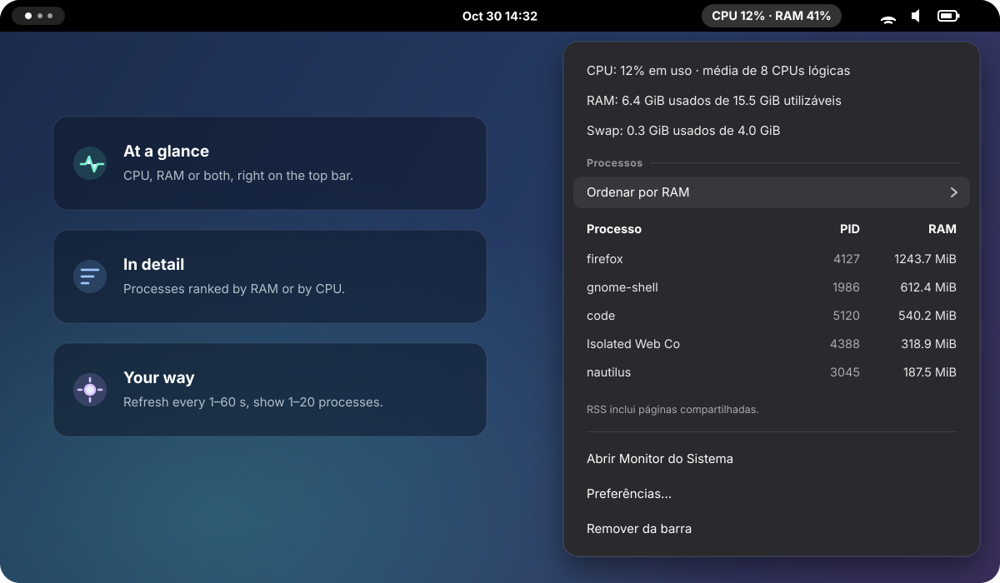

<div align="center">

<sub><a href="README.md">🇧🇷 Português</a> · <b>🇺🇸 English</b></sub>


<br>

<p>
  
  
  
  
</p>

**CPU, memory and the hungriest processes — right on the GNOME top bar.**<br>
<sub>Lightweight, no runtime dependencies, and everything configurable in one click.</sub>

<p>
  <a href="#-quick-install"><b>Install</b></a> ·
  <a href="#-usage">Usage</a> ·
  <a href="#-metrics">Metrics</a> ·
  <a href="#-development">Development</a> ·
  <a href="#-verification">Verification</a>
</p>

<br>



</div>

<br>

> [!NOTE]
> The widget interface is currently in **Portuguese**. It uses gettext with the
> `system-pulse` domain, so it is ready for translation catalogs.

## ✨ Highlights

<table>
  <tr>
    <td width="33%" valign="top">
      <h3>📈 At a glance</h3>
      CPU, RAM or both on the top bar, refreshed every <b>1 to 60 seconds</b>.
    </td>
    <td width="33%" valign="top">
      <h3>🔍 In detail</h3>
      Usable memory, swap and processes ranked by <b>RAM (RSS)</b> or <b>recent CPU</b>.
    </td>
    <td width="33%" valign="top">
      <h3>⚙️ Your way</h3>
      Choose what the bar shows and <b>1 to 20 processes</b>. Changes apply instantly.
    </td>
  </tr>
  <tr>
    <td width="33%" valign="top">
      <h3>🪶 Lightweight</h3>
      Processes are only read while the menu is open — asynchronously and cancellably.
    </td>
    <td width="33%" valign="top">
      <h3>🛟 Safe</h3>
      Updates come with automatic backups and rollback on failure.
    </td>
    <td width="33%" valign="top">
      <h3>🧪 Reliable</h3>
      100% line, branch and function coverage, in strict TypeScript.
    </td>
  </tr>
</table>

> [!TIP]
> **Defaults:** CPU and RAM on the bar · refresh every **2 seconds** ·
> the **5 processes** using the most RAM.

## 🚀 Quick install

From the project folder, **without `sudo`**:

```sh
node install.ts
```

That’s it. The installer checks your environment, installs npm dependencies,
builds the project, copies the files, installs the mascot icon, creates the
**System Pulse — Adicionar à barra** launcher and tries to enable the extension.

> [!NOTE]
> **Widget not showing up?** If GNOME doesn’t recognize the extension yet, save
> your work, log out and back in. Then open the launcher or run
> `gnome-extensions enable ram-widget@local`.

### Requirements

| | Requirement | Used for |
|:-:| --- | --- |
| 🐧 | Linux with **GNOME Shell 50** | Running the extension. |
| 🟢 | **Node.js 24+** and **npm** | Running the installer and compiling TypeScript. |
| 📋 | **`ps`**, from the `procps` package | Querying processes. |
| 🧩 | **`glib-compile-schemas`** (`libglib2.0-bin` on Ubuntu) | Compiling the GSettings preferences. |
| 📊 | **System Monitor** <sub>optional</sub> | The button that opens the GNOME app. |

Missing dependencies are reported before installing; Node.js is not installed
automatically. Once built, the widget runs on GNOME’s GJS — Node.js and
`node_modules` are only used by the project tooling.

### Installer options

| Option | Effect |
| --- | --- |
| `--dev` | Installs a link to this checkout, for development. |
| `--skip-build` | Uses an existing build, without running `npm ci` or compiling. |
| `--with-system-monitor` | Also installs System Monitor via `sudo apt-get`, if needed. |
| `--dest-dir PATH` | Installs to another folder, without enabling the extension or refreshing the session catalog. |
| `--help` | Shows help. |

```sh
# Include System Monitor (Ubuntu/Debian) — the only option that uses sudo
node install.ts --with-system-monitor

# Validate an install into a temporary folder, using an existing build
node install.ts --skip-build --dest-dir /tmp/system-pulse-test
```

System Monitor can also be installed separately with
`sudo apt install gnome-system-monitor`, and `npm run setup` is a shortcut for the installer.

<details>
<summary><b>📁 Install location, updates and backups</b></summary>

<br>

The installer uses `$XDG_DATA_HOME` when it is an absolute path, or
`~/.local/share` by default.

| Item | Path relative to the data directory |
| --- | --- |
| Extension | `gnome-shell/extensions/ram-widget@local/` |
| Launcher | `applications/ram-widget-enable.desktop` |
| Mascot | `icons/hicolor/512x512/apps/system-pulse.png` |
| Backups | `system-pulse/backups/` |

Normal mode installs an independent copy of the project. If a development link
exists, it is replaced by the copy; use `--dev` to keep the link.

On updates, the previous extension, icon and launcher are kept in a backup, and
`restore.json` records the original location of each item. If replacing fails,
the installer tries to restore the previous files. GSettings preferences are
preserved.

</details>

## 🖱️ Usage

| In the widget menu | What it does |
| --- | --- |
| **Ordenar por** <sub>(sort by)</sub> | Switches the ranking between **RAM (RSS)** and **CPU (recent activity)**. |
| **Preferências…** <sub>(preferences)</sub> | Picks the bar content, refresh interval and process count — saved and applied instantly. |
| **Abrir Monitor do Sistema** <sub>(open System Monitor)</sub> | Launches the GNOME app, or explains how to install it. |
| **Remover da barra** <sub>(remove from bar)</sub> | Disables the extension and stops updates; files and preferences stay. |

### Adding it back to the bar

Press <kbd>Super</kbd>, search for **System Pulse** and open
**System Pulse — Adicionar à barra**. You can also pin that launcher to your
favorites or enable the widget from the **Extensions** app. From a terminal in
the session:

```sh
gnome-extensions enable ram-widget@local    # enable
gnome-extensions disable ram-widget@local   # disable
gnome-extensions info ram-widget@local      # check status
```

Re-enabling an already loaded version doesn’t require logging out. The widget
stays disabled until you enable it again, even across GNOME sessions.

## 📊 Metrics

| Metric | How to read it |
| --- | --- |
| **Total CPU** | Average over all logical CPUs, 0 to 100%, between two reads of `/proc/stat`. Idle and I/O wait time don’t count as usage. |
| **Per-process CPU** | Recent activity, normalized to total capacity. With 8 logical CPUs, one fully busy CPU is ~12.5%. |
| **RAM used** | `MemTotal − MemAvailable`. Usable total may be lower than installed RAM because of hardware and system reservations. |
| **Swap used** | `SwapTotal − SwapFree`. Without swap, the menu says so. |
| **Per-process RAM (RSS)** | Includes shared pages — summing processes doesn’t give total RAM usage. |

The **`…`** symbol means a second valid sample is still needed to compute CPU.
The list includes processes with RSS above zero and shows each PID on its own,
even when several belong to the same application.

<details>
<summary><b>🔬 Sampling, processes and edge cases</b></summary>

<br>

Per-process CPU uses the delta of `utime + stime` from `/proc/PID/stat`, divided
by the advance of the total counters. The percentage covers the recent interval,
not the average since the process started. For total CPU, `guest` and
`guest_nice` are already included in other counters and aren’t added twice.

PID reuse, a change in CPU count or counter regression resets sampling.
Processes without two valid samples go to the end of the CPU ranking.

Processes are only queried while the menu is open. Each opening starts a new
sampling; the percentage appears after the next interval. Reads are asynchronous
with bounded concurrency. Closing the menu or disabling the extension cancels
pending queries. Disabling also removes the timer and preference signals.

</details>

## 🛠️ Development

```sh
node install.ts --dev   # link the install to this checkout
npm ci                  # install dependencies
npm run build           # compile src/ → build/, generate extension.js, prefs.js and the schema
npm run watch           # recompile TypeScript on every change
```

Edit only source files; generated files are recreated on the next build. After
changing the schema XML, run the full build again. Preferences changed through
the UI need neither a build nor a restart.

### Nested GNOME session in a window

On Wayland, the JavaScript of an already loaded extension only updates in a new
GNOME session — disabling and re-enabling isn’t enough. The windowed session lets
you restart just the test session, without closing your desktop.

1. Install the development tooling on Ubuntu, once:

   ```sh
   sudo apt install mutter-dev-bin
   ```

2. From a terminal on your main desktop, start the test GNOME:

   ```sh
   dbus-run-session gnome-shell --devkit --wayland
   ```

3. Inside the test window, open a terminal and enable the extension:

   ```sh
   gnome-extensions enable ram-widget@local
   ```

4. Edit `src/`, run `npm run build`, close the test window and repeat step 2.

Diagnostics appear in the terminal that started the test GNOME, and that session
uses the same user’s files.

<details>
<summary><b>🗂️ Code layout</b></summary>

<br>

| Path | Responsibility |
| --- | --- |
| [`src/extension.ts`](src/extension.ts) · [`src/controller.ts`](src/controller.ts) | Extension entry point, lifecycle, timer and UI updates. |
| [`src/data/`](src/data/) | DTOs as separate classes with `readonly` properties. |
| [`src/domain/`](src/domain/) | Parsers, calculations, ranking and selection types, with no GNOME dependency. |
| [`src/services/`](src/services/) | CPU/memory sampling and asynchronous process queries. |
| [`src/platform/`](src/platform/) | File reading and System Monitor integration. |
| [`src/presenters/`](src/presenters/) | Formatting metrics into presentation DTOs. |
| [`src/ui/`](src/ui/) | Indicator, process rows and preferences window. |
| [`src/settings.ts`](src/settings.ts) · [`src/prefs.ts`](src/prefs.ts) · [`schemas/`](schemas/) | Typed settings, preferences entry point and GSettings schema. |
| [`scripts/`](scripts/) · [`install.ts`](install.ts) | Build, installer and backed-up updates. |
| [`tests/`](tests/) | Domain, DTO, service, UI and installer tests. |

</details>

<details>
<summary><b>🧭 TypeScript, native APIs and translation</b></summary>

<br>

All first-party source — installer, build and tests included — is TypeScript,
with `strict`, `noUncheckedIndexedAccess`, `exactOptionalPropertyTypes` and
`noImplicitOverride`, and no `any`, error suppressions or non-null assertions.

External APIs use `@girs` for GNOME Shell 50. `skipLibCheck` skips checking those
declarations internally, but the project’s use of them is still type-checked.
Data from `/proc` is also validated at runtime.

Free functions are arrow functions, control flow always uses braces, and the code
favors early returns. GNOME Shell imports are direct; `gi://` modules keep the
default import GJS requires. GTK/Adwaita are only loaded in the preferences process.

The UI uses gettext with the `system-pulse` domain. Without an installed catalog,
the original Portuguese strings are shown.

</details>

## ✅ Verification

```sh
npm run check
```

Type-checks, requires **100% line, branch and function coverage** and finishes
with a full build.

| Command | Checks |
| --- | --- |
| `npm run typecheck` | Types for the extension, preferences, tooling and tests. |
| `npm test` | Domain, DTO, UI, service and installer tests. |
| `npm run coverage` | Tests with the required coverage thresholds. |
| `npm run check` | Types, coverage and build. |

Coverage uses Node.js’s V8 and includes `src/`, `scripts/` and `install.ts`, with
no comment-based exclusions. Tests cover CPU counters, inconsistent memory, swap,
PID reuse, ranking, preferences, query cancellation, installation, backup and
restore. GNOME APIs and external commands are mocked; installer file tests use
real temporary directories. Visual checks happen in the nested GNOME session.

<details>
<summary><b>🏷️ Compatibility with the former RAM Widget</b></summary>

<br>

The project is now called **System Pulse**. The `ram-widget@local` UUID, the
GSettings schema and path, and the installed launcher ID were kept to preserve
preferences, activation and favorites. Installing works regardless of the
checkout folder name.

</details>

---

<div align="center">
  
  <br>
  <sub>
    Made with 💚 for GNOME ·
    <a href="https://gjs.guide/extensions/development/creating.html">Creating an extension</a> ·
    <a href="https://gjs.guide/extensions/topics/popup-menu.html">Menus</a> ·
    <a href="https://gjs.guide/extensions/development/debugging.html#reloading-extensions">Debugging</a>
  </sub>
</div>
