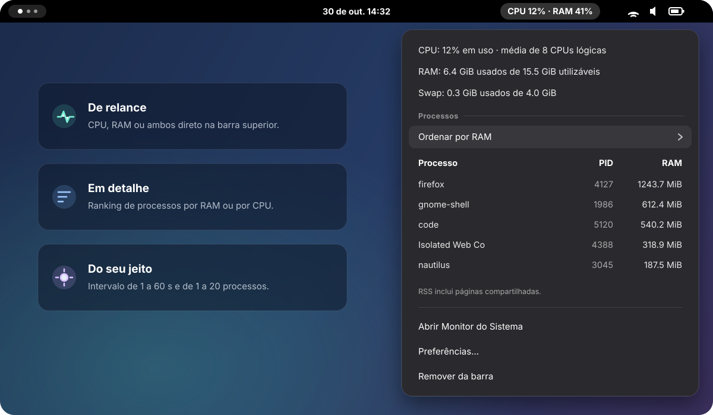
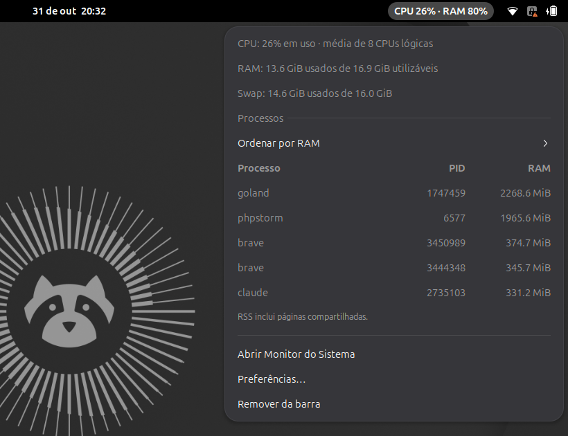

<div align="center">

<sub><b>🇧🇷 Português</b> · <a href="README.en.md">🇺🇸 English</a></sub>


<br>

<p>
  <a href="https://extensions.gnome.org/extension/11577/system-pulse/"></a>
  
  
  
  
  <a href="https://gitlab.com/danie1net0/system-pulse/-/pipelines"></a>
  <a href="LICENSE"></a>
</p>

**CPU, memória e os processos que mais consomem — direto na barra superior do GNOME.**<br>
<sub>Leve, sem dependências em execução e com tudo configurável a um clique.</sub>

<p>
  <a href="#-instalação-rápida"><b>Instalar</b></a> ·
  <a href="#-usar">Usar</a> ·
  <a href="#-métricas">Métricas</a> ·
  <a href="#-xfce">XFCE</a> ·
  <a href="#-desenvolver">Desenvolver</a> ·
  <a href="#-verificar">Verificar</a>
</p>

<br>



</div>

<br>

## ✨ Destaques

<table>
  <tr>
    <td width="33%" valign="top">
      <h3>📈 De relance</h3>
      CPU, RAM ou ambos na barra superior, atualizados a cada <b>1 a 60 segundos</b>.
    </td>
    <td width="33%" valign="top">
      <h3>🔍 Em detalhe</h3>
      Memória utilizável, swap e o ranking de processos por <b>RAM (RSS)</b> ou <b>CPU recente</b>.
    </td>
    <td width="33%" valign="top">
      <h3>⚙️ Do seu jeito</h3>
      Escolha o conteúdo da barra e de <b>1 a 20 processos</b>. Tudo é aplicado na hora.
    </td>
  </tr>
  <tr>
    <td width="33%" valign="top">
      <h3>🪶 Leve</h3>
      Processos só são lidos com o menu aberto, de forma assíncrona e cancelável.
    </td>
    <td width="33%" valign="top">
      <h3>🛟 Seguro</h3>
      Atualizações com backup automático e restauração em caso de falha.
    </td>
    <td width="33%" valign="top">
      <h3>🧪 Confiável</h3>
      100% de cobertura de linhas, branches e funções, em TypeScript estrito.
    </td>
  </tr>
</table>

### 📸 Na prática

<p align="center">
  
</p>

> [!TIP]
> **Configuração padrão:** CPU e RAM na barra · atualização a cada **2 segundos** ·
> os **5 processos** que mais usam RAM.

## 🚀 Instalação rápida

O jeito mais simples é instalar pelo **[extensions.gnome.org](https://extensions.gnome.org/extension/11577/system-pulse/)**: abra a página
no navegador com a integração do GNOME Shell e clique em **Instalar**, ou use o
app **Gerenciador de Extensões**. O site publica só versões já revisadas; para a mais
recente, use o instalador abaixo.

### A partir do código

Na pasta do projeto, **sem `sudo`**:

```sh
node install.ts
```

Pronto. O instalador verifica o ambiente, instala as dependências npm, compila o
projeto, copia os arquivos, instala o mascote, cria o atalho
**System Pulse — Adicionar à barra** e tenta habilitar a extensão.

<details>
<summary><b>📦 Sem Node.js: instalar pelo pacote da release</b></summary>

<br>

Baixe `system-pulse.shell-extension.zip` na
[página de releases](https://gitlab.com/danie1net0/system-pulse/-/releases) e execute:

```sh
gnome-extensions install --force system-pulse.shell-extension.zip
```

Depois, saia da sessão e entre novamente, e ative com
`gnome-extensions enable system-pulse@danie1net0.gitlab.io`. Esse modo não cria o
atalho com o mascote.

</details>

> [!NOTE]
> **O widget não apareceu?** Se o GNOME ainda não reconhecer a extensão, salve seu
> trabalho, saia da sessão e entre novamente. Depois, abra o atalho ou execute
> `gnome-extensions enable system-pulse@danie1net0.gitlab.io`.

### Requisitos

| | Requisito | Para quê |
|:-:| --- | --- |
| 🐧 | Linux com **GNOME Shell 50** | Executar a extensão. |
| 🟢 | **Node.js 24+** e **npm** | Executar o instalador e compilar o TypeScript. |
| 📋 | **`ps`**, do pacote `procps` | Consultar os processos. |
| 🧩 | **`glib-compile-schemas`** (`libglib2.0-bin` no Ubuntu) | Compilar as preferências GSettings. |
| 📊 | **Monitor do Sistema** <sub>opcional</sub> | Usar o botão que abre o aplicativo do GNOME. |

As dependências ausentes são informadas antes da instalação; o Node.js não é
instalado automaticamente. Depois de compilado, o widget roda no GJS do GNOME —
Node.js e `node_modules` servem apenas às ferramentas do projeto.

### Opções do instalador

| Opção | Efeito |
| --- | --- |
| `--dev` | Instala um link para este checkout, para desenvolvimento. |
| `--skip-build` | Usa um build existente, sem executar `npm ci` nem compilar. |
| `--with-system-monitor` | Instala também o Monitor do Sistema via `sudo apt-get`, se necessário. |
| `--dest-dir CAMINHO` | Instala em outra pasta, sem ativar a extensão nem atualizar o catálogo da sessão. |
| `--help` | Exibe a ajuda. |

```sh
# Incluir o Monitor do Sistema (Ubuntu/Debian) — única opção que usa sudo
node install.ts --with-system-monitor

# Validar uma instalação em pasta temporária, com o build já preparado
node install.ts --skip-build --dest-dir /tmp/system-pulse-teste
```

O Monitor do Sistema também pode ser instalado à parte com
`sudo apt install gnome-system-monitor`, e `npm run setup` é um atalho para o instalador.

<details>
<summary><b>📁 Destino da instalação, atualizações e backups</b></summary>

<br>

A instalação usa `$XDG_DATA_HOME` quando ele é um caminho absoluto, ou
`~/.local/share` por padrão.

| Item | Caminho relativo ao diretório de dados |
| --- | --- |
| Extensão | `gnome-shell/extensions/system-pulse@danie1net0.gitlab.io/` |
| Atalho | `applications/system-pulse-enable.desktop` |
| Mascote | `icons/hicolor/512x512/apps/system-pulse.png` |
| Backups | `system-pulse/backups/` |

O modo normal instala uma cópia independente do projeto. Se houver um link de
desenvolvimento, ele será substituído pela cópia; use `--dev` para manter o link.

Em atualizações, a extensão anterior, o ícone e o atalho são preservados em um
backup, e o arquivo `restore.json` registra o destino original de cada item. Se
ocorrer erro durante a substituição, o instalador tenta restaurar os arquivos
anteriores. As preferências GSettings são preservadas.

</details>

## 🖱️ Usar

| No menu do widget | O que acontece |
| --- | --- |
| **Ordenar por** | Alterna o ranking entre **RAM (RSS)** e **CPU (atividade recente)**. |
| **Preferências…** | Escolhe o conteúdo da barra, o intervalo e a quantidade de processos — salvo e aplicado na hora. |
| **Abrir Monitor do Sistema** | Inicia o aplicativo do GNOME ou explica como instalá-lo. |
| **Remover da barra** | Desativa a extensão e interrompe as atualizações; arquivos e preferências permanecem. |

### Adicionar de volta à barra

Pressione <kbd>Super</kbd>, pesquise **System Pulse** e abra
**System Pulse — Adicionar à barra**. Você também pode fixar esse atalho nos
favoritos ou ativar o widget pelo aplicativo **Extensões**. Pelo terminal da sessão:

```sh
gnome-extensions enable system-pulse@danie1net0.gitlab.io    # ativar
gnome-extensions disable system-pulse@danie1net0.gitlab.io   # desativar
gnome-extensions info system-pulse@danie1net0.gitlab.io      # conferir o estado
```

Reativar uma versão já carregada não exige sair da sessão. O widget permanece
desativado até você reativá-lo, inclusive após sair e entrar no GNOME.

## 📊 Métricas

| Métrica | Como interpretar |
| --- | --- |
| **CPU total** | Média de todas as CPUs lógicas, de 0 a 100%, entre duas leituras de `/proc/stat`. Tempo ocioso e espera de I/O ficam fora do uso. |
| **CPU por processo** | Atividade recente, normalizada pela capacidade total. Com 8 CPUs lógicas, uma CPU totalmente ocupada equivale a ~12,5%. |
| **RAM usada** | `MemTotal − MemAvailable`. O total utilizável pode ser menor que a RAM instalada por causa de reservas do hardware e do sistema. |
| **Swap usada** | `SwapTotal − SwapFree`. Sem swap, o menu informa isso. |
| **RAM por processo (RSS)** | Inclui páginas compartilhadas — somar os processos não dá o consumo total de RAM. |

O símbolo **`…`** indica que ainda falta uma segunda amostra válida para calcular
CPU. A lista considera processos com RSS maior que zero e mostra cada PID
individualmente, mesmo quando vários pertencem ao mesmo aplicativo.

<details>
<summary><b>🔬 Amostragem, processos e casos de borda</b></summary>

<br>

A CPU de cada processo usa a diferença de `utime + stime` em `/proc/PID/stat`,
dividida pelo avanço dos contadores totais. O percentual representa o intervalo
recente, e não a média desde a criação do processo. Na CPU total, `guest` e
`guest_nice` já estão incluídos nos outros contadores e não são somados novamente.

Reuso de PID, mudança na quantidade de CPUs e regressão de contadores reiniciam
a amostragem. Processos sem duas amostras válidas ficam no final do ranking por CPU.

Os processos são consultados somente com o menu aberto. Cada abertura inicia uma
nova amostragem; a porcentagem aparece após o próximo intervalo. A leitura é
assíncrona, com concorrência limitada. Fechar o menu ou desativar a extensão
cancela as consultas pendentes. Desativar também remove o temporizador e os sinais
de preferências.

</details>

## 🐭 XFCE

Fora do GNOME, o System Pulse funciona no painel do **XFCE** pelo plugin
**Monitor Genérico** (Generic Monitor). É um script em `sh` + `awk`, sem Node.js nem
outras dependências em execução: a barra mostra `CPU 12% · RAM 41%`, o tooltip
traz memória, swap e os processos que mais usam RAM, e o clique abre o
gerenciador de tarefas.

```sh
sudo apt install xfce4-genmon-plugin   # uma vez, se ainda não tiver
xfce/install.sh                        # copia para ~/.local/bin, sem sudo
```

Depois, clique com o botão direito no painel → **Painel → Adicionar novos itens →
Monitor Genérico** e, nas propriedades, use o comando
`~/.local/bin/system-pulse-genmon`, desmarque o rótulo e defina o período em
2 segundos.

| Opção | Efeito |
| --- | --- |
| `--mode both\|cpu\|ram` | Métricas exibidas no painel. Padrão: `both`. |
| `--count 1-20` | Processos listados no tooltip. Padrão: `5`. |
| `--process-every N` | Refaz a lista de processos a cada N atualizações. Padrão: `5`. |

> [!NOTE]
> O Monitor Genérico executa o comando a cada atualização. Por isso, só os números
> da barra são lidos toda vez (~6 ms). A lista de processos, a parte mais cara,
> é refeita a cada 5 atualizações.

## 🛠️ Desenvolver

```sh
node install.ts --dev   # conecta a instalação a este checkout
npm ci                  # instala as dependências
npm run build           # compila src/ → build/, gera extension.js, prefs.js e o schema
npm run watch           # recompila o TypeScript a cada alteração
npm run pack            # gera dist/system-pulse.shell-extension.zip para a release
```

Edite apenas os arquivos de origem; os gerados são recriados no próximo build.
Depois de alterar o XML do schema, execute o build completo novamente.
Preferências alteradas pela interface não precisam de build nem reinício.

### GNOME de teste em uma janela

Em Wayland, o JavaScript de uma extensão já carregada só é atualizado numa nova
sessão do GNOME — desativar e reativar não basta. O ambiente em janela permite
reiniciar apenas a sessão de teste, sem fechar o seu desktop.

1. Instale o suporte de desenvolvimento no Ubuntu, uma única vez:

   ```sh
   sudo apt install mutter-dev-bin
   ```

2. Em um terminal do desktop principal, abra o GNOME de teste:

   ```sh
   dbus-run-session gnome-shell --devkit --wayland
   ```

3. Dentro da janela de teste, abra um terminal e habilite a extensão:

   ```sh
   gnome-extensions enable system-pulse@danie1net0.gitlab.io
   ```

4. Edite `src/`, rode `npm run build`, feche a janela de teste e repita o passo 2.

Os diagnósticos aparecem no terminal que iniciou o GNOME de teste, e essa sessão
usa os arquivos do mesmo usuário.

<details>
<summary><b>🗂️ Organização do código</b></summary>

<br>

| Caminho | Responsabilidade |
| --- | --- |
| [`src/extension.ts`](src/extension.ts) · [`src/controller.ts`](src/controller.ts) | Entrada da extensão, ciclo de vida, temporizador e atualização da interface. |
| [`src/data/`](src/data/) | DTOs em classes separadas, com propriedades `readonly`. |
| [`src/domain/`](src/domain/) | Parsers, cálculos, ranking e tipos de seleção, sem dependência do GNOME. |
| [`src/services/`](src/services/) | Amostragem de CPU/memória e consulta assíncrona de processos. |
| [`src/platform/`](src/platform/) | Leitura de arquivos e integração com o Monitor do Sistema. |
| [`src/presenters/`](src/presenters/) | Formatação das métricas nos DTOs de apresentação. |
| [`src/ui/`](src/ui/) | Indicador, linhas de processos e tela de preferências. |
| [`src/settings.ts`](src/settings.ts) · [`src/prefs.ts`](src/prefs.ts) · [`schemas/`](schemas/) | Configurações tipadas, entrada das preferências e schema GSettings. |
| [`xfce/`](xfce/) | Versão para o painel do XFCE (Monitor Genérico) e seu instalador. |
| [`po/`](po/) | Catálogos de tradução; o build os compila para `locale/`. |
| [`scripts/`](scripts/) · [`install.ts`](install.ts) | Build, empacotamento, traduções, instalador e atualização com backup. |
| [`tests/`](tests/) | Testes de domínio, DTOs, serviços, interface e instalação. |

</details>

<details>
<summary><b>🧭 TypeScript, APIs nativas e tradução</b></summary>

<br>

Todo o código-fonte próprio — instalador, build e testes incluídos — está em
TypeScript, com `strict`, `noUncheckedIndexedAccess`, `exactOptionalPropertyTypes`
e `noImplicitOverride`, sem `any`, supressões de erro ou asserções de não nulidade.

As APIs externas usam `@girs` para GNOME Shell 50. `skipLibCheck` evita checar
internamente essas declarações, mas o uso delas pelo projeto continua verificado.
Os dados de `/proc` também são validados em execução.

As funções livres usam arrow functions, os controles de fluxo têm chaves e o
código usa retornos antecipados. Os imports do GNOME Shell são diretos; os módulos
`gi://` mantêm o import padrão exigido pelo GJS. GTK/Adwaita são carregados apenas
no processo de preferências.

A interface usa gettext com o domínio `system-pulse` e acompanha o idioma do
sistema: português (original) e inglês ([`po/en.po`](po/en.po)). O build compila
os catálogos em TypeScript, sem depender de `msgfmt`, e um teste garante que toda
mensagem da interface tenha tradução. Para outro idioma, adicione `po/<idioma>.po`.

</details>

## ✅ Verificar

```sh
npm run check
```

Verifica os tipos, exige **100% de cobertura de linhas, branches e funções** e
conclui com o build completo.

| Comando | Verificação |
| --- | --- |
| `npm run typecheck` | Tipagem da extensão, preferências, ferramentas e testes. |
| `npm test` | Testes de domínio, DTOs, interface, serviços e instalador. |
| `npm run coverage` | Testes com os limites obrigatórios de cobertura. |
| `npm run check` | Tipagem, cobertura e build. |

A cobertura usa o V8 do Node.js e inclui `src/`, `scripts/` e `install.ts`, sem
exclusões por comentários. Os testes cobrem contadores de CPU, memória
inconsistente, swap, reuso de PID, ranking, preferências, cancelamento de
consultas, instalação, backup e restauração. As APIs do GNOME e os comandos
externos são simulados; os testes de arquivos do instalador usam diretórios
temporários reais. A verificação visual é feita no GNOME de teste.

## 📄 Licença

Distribuído sob a [licença MIT](LICENSE). Use, modifique e redistribua à vontade.

O repositório principal fica no [GitLab](https://gitlab.com/danie1net0/system-pulse);
o [GitHub](https://github.com/danie1net0/system-pulse) é uma réplica automática.
Issues e merge requests são bem-vindos no GitLab.

---

<div align="center">
  
  <br>
  <sub>
    Feito com 💚 para o GNOME ·
    <a href="https://gjs.guide/extensions/development/creating.html">Criar uma extensão</a> ·
    <a href="https://gjs.guide/extensions/topics/popup-menu.html">Menus</a> ·
    <a href="https://gjs.guide/extensions/development/debugging.html#reloading-extensions">Depuração</a>
  </sub>
</div>
